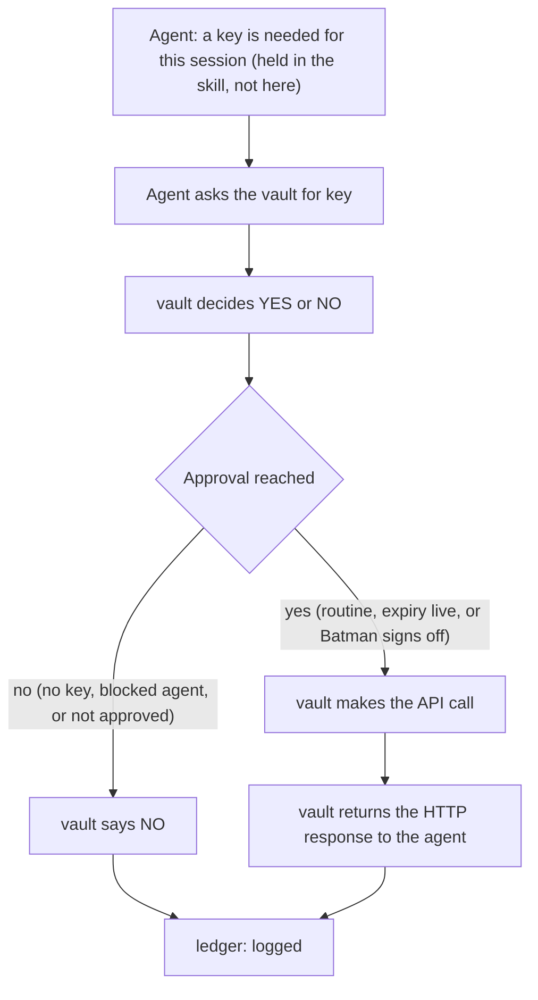

# private-api-vault — API key request flow

The agent does not hold API keys (keys live only in the vault's encrypted
store). Every session that needs a key asks the vault. The vault decides
yes or no, and on a yes makes the call itself and returns the HTTP
response. A key value never leaves the vault.

## What the vault does

- Decides YES or NO on every key request.
- YES comes from a rule (routine / expiry still live) or from Batman's
  sign-off.
- On YES it doesn't hand a key out — it runs the call itself and returns
  the HTTP response.
- On NO it says so, and the agent is refused.
- Every decision is written to the ledger.

That's the whole map. The agent asks, the vault answers, the ledger records.
