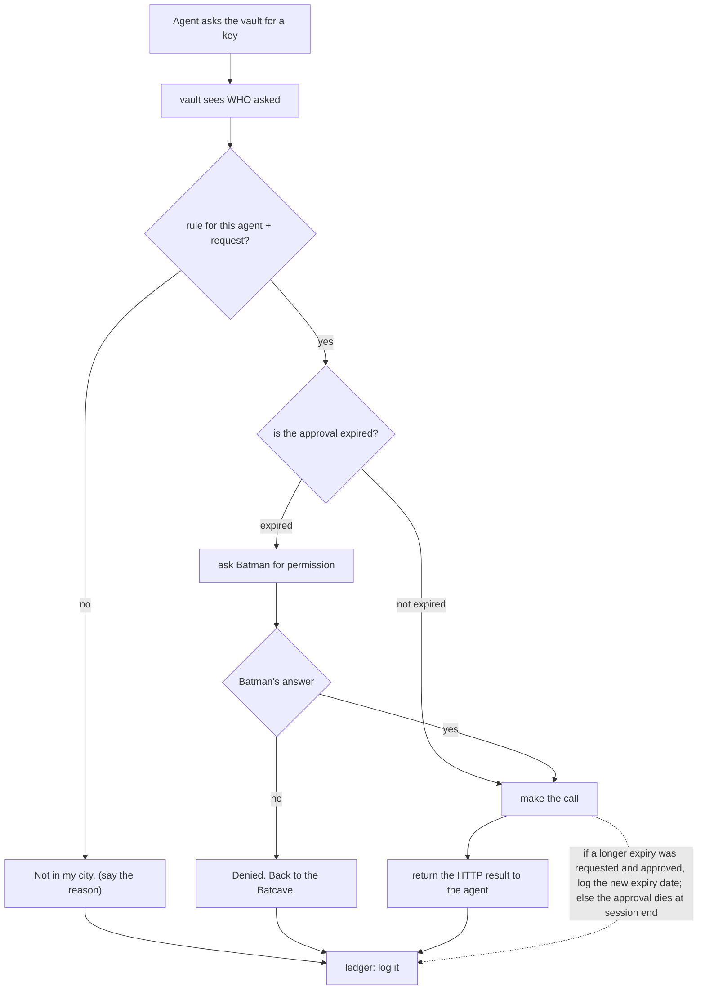

# private-api-vault — API key request flow

The agent has no key. It asks the vault. The vault runs the logic below
and answers ONE of two things: "fuck off" (with the reason) or "here is
the HTTP result". A key value never leaves the vault.

## The vault's logic, in order

1. Who asked? Apply the rule for that agent + request.
   - NO → "Not in my city." — with the reason.
2. YES → is the approval expired?
   - Not expired → make the call.
   - Expired → go get Batman's permission.
3. Batman's answer:
   - NO → "Denied. Back to the Batcave."
   - YES → make the call. If a longer expiry was requested AND approved, log
     the new expiry date; otherwise the approval is only good until the
     session ends (dies by default).

The vault answers the requesting agent with either a refusal (with reason)
or the HTTP result. Every decision is logged.

That's the whole logic.