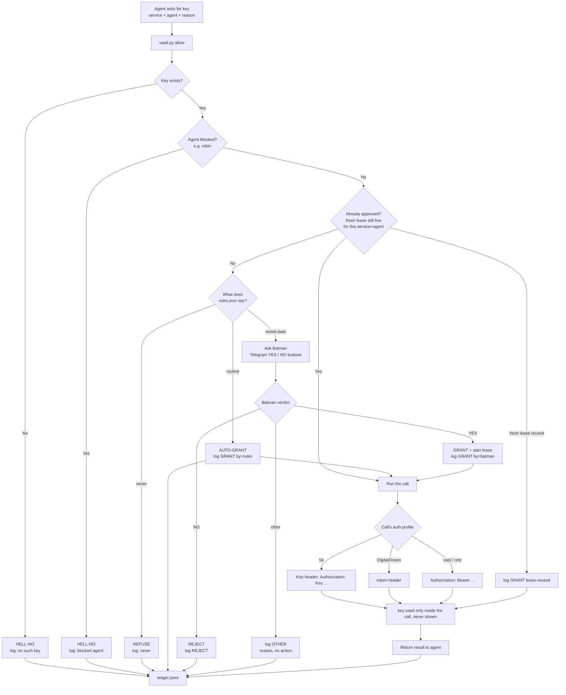

# private-api-vault — API key request flow

How a request for a service key is decided. Every path ends in a ledger
line — WHO asked, for WHAT, WHEN, and the OUTCOME. A keyis never handed
to an agent; the vault decrypts internally and makes the call itself.

## Legend

- **routine**    — low-stakes, same agent always gets it → auto-grant (still logged)
- **needs-bats** — anything costing money or risky → Batman must tap YES
- **never**      — rules release it under no circumstances
- **lease**      — an approval is valid for N minutes; while it's live we do NOT
                  re-ask Batman (reused and logged as lease-reused). Only an
                  expired lease triggers a fresh ask.

Rule of thumb: Batman is only ever asked when a key is genuinely needed,
not already approved, and rules mark it needs-bats. Fast paths (routine,
live lease) never bother him. Every node → the ledger; nothing happens
unlogged.