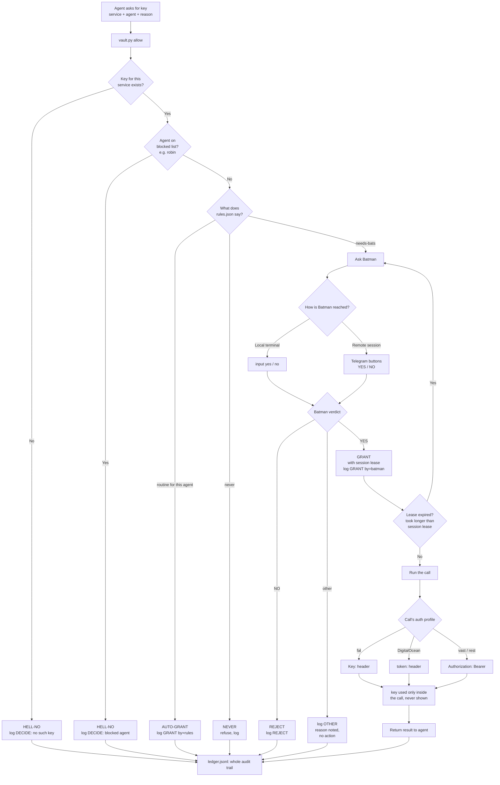

# private-api-vault — API key request flow

How a request for a service key is decided. Every path ends in a ledger
line — WHO asked, for WHAT, WHEN, and the OUTCOME. A keyis never handed
to an agent; the vault decrypts internally and makes the call itself.

## Legend

- **routine**   — low-stakes, same agent always gets it (auto-grant, still logged)
- **needs-bats** — anything costing money or risky: Batman must tap YES
- **never**     — rules say no circumstances release it
- **lease**     — approval is only valid for N minutes; a long job re-asks

Every node → the ledger. Nothing happens unlogged.