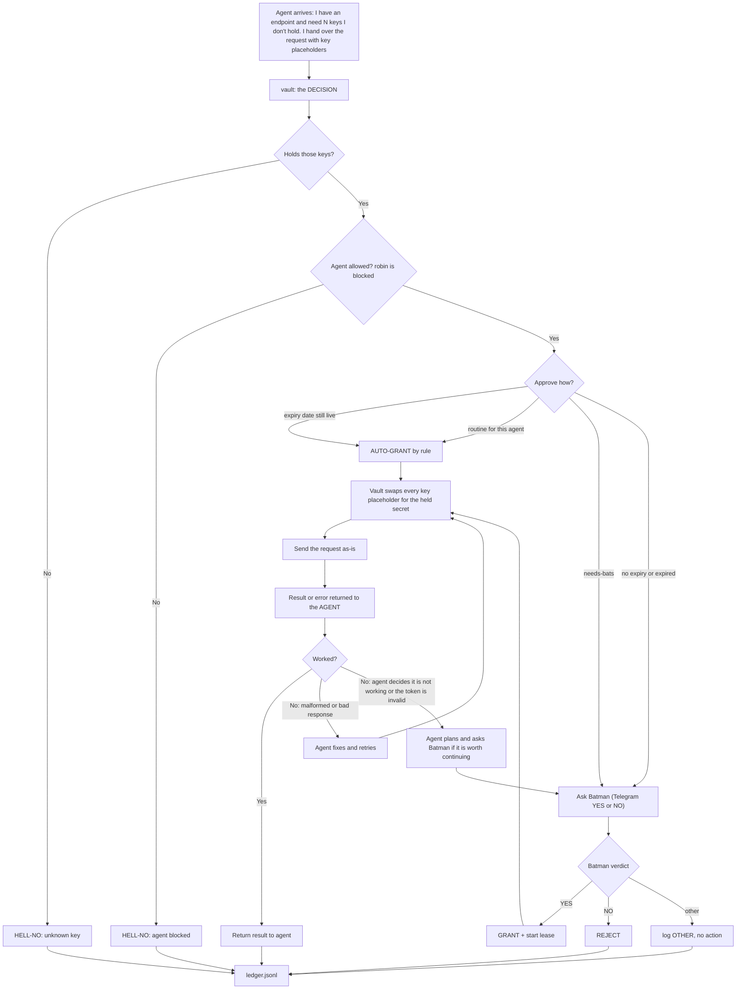

# private-api-vault — API key request flow

The vault's ONE job: DECIDE who gets a key and who doesn't — Batman signs
off, unless a rule or expiry auto-approves. Everything else (the request's
shape, the call, fixing a bad response) belongs to the agent. The vault
just holds the secrets, substitutes them into a string it's handed, sends,
and reports back. A key value never leaves the vault's process.

## The division of labour (read this — it IS the design)

- **The vault decides only one thing: does this agent get this key?**
  Rules + your sign-off + expiry windows. That decision path is all the
  vault's code cares about.
- **The vault does NOT understand templates or endpoints.** It never learns
  "fal needs a Key header" or any provider's auth shape. It is handed a
  finished request string containing `[key_name]` markers, swaps in the
  secrets it holds, sends it, returns whatever comes back.
- **If a call comes back badly formed -> the AGENT fixes and retries.** The
  vault doesn't debug the request; it just tries the send and hands the
  result back.
- **If the agent concludes the thing is genuinely not working (endpoint
  dead, token invalid, money burning) -> the agent plans and asks Batman,
  not the vault.** That's a "is it worth continuing?" decision, so it
  routes to the same approval path — you.
- **One endpoint may need several secrets.** The vault holds however many
  keys a service needs and replaces every mark placeholder it finds. So
  "three secrets or one" is automatic — it swaps every placeholder.

Every decision goes to the ledger. Nothing unlogged.
